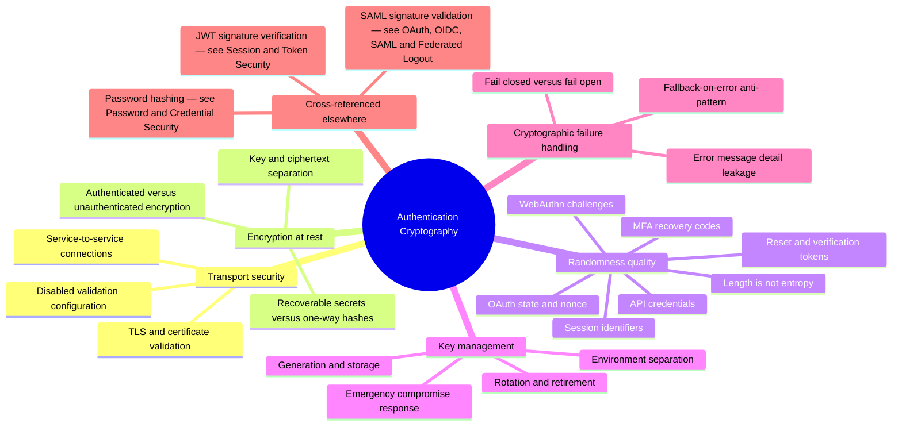

# Authentication Cryptography — Mind Map

Zoom-in covering `attack-guides/15-CRYPTOGRAPHIC-FAILURES.md`, which deliberately excludes JWT/token signature-verification content (that lives in `attack-guides/04-JWT-AND-TOKEN-SECURITY.md`) to avoid duplicating the two guides. This map therefore shows the cryptographic surface as a whole, with the JWT branch marked as cross-referenced rather than owned here.

## Why this cluster holds together

Every branch here answers a version of the same question: does the implementation actually deliver the specific cryptographic property (confidentiality, integrity, authenticity, unpredictability) it's relying on, in its *real deployed configuration* — not the property its algorithm's name suggests it should have. HMAC-SHA-256 is strong with a hardcoded secret; AES is strong with a key stored next to its own ciphertext; a CSPRNG-backed token generator is strong until a *secondary* value like a recovery code gets generated with less rigor because it wasn't treated as equally sensitive. The recurring root cause across this whole guide is exactly that asymmetry — primary credentials get cryptographic rigor, secondary ones quietly don't.

## Entry point

Use `15-CRYPTOGRAPHIC-FAILURES.md` for TLS, encryption-at-rest, randomness, and key-management testing. For signature verification specifically, go to `04-JWT-AND-TOKEN-SECURITY.md` (JWT) or `OAUTH-OIDC-AND-SAML.md` (SAML/OIDC ID tokens) — this guide's "fail-closed vs. fallback-on-error" discipline applies equally to both and is worth reading alongside them.
