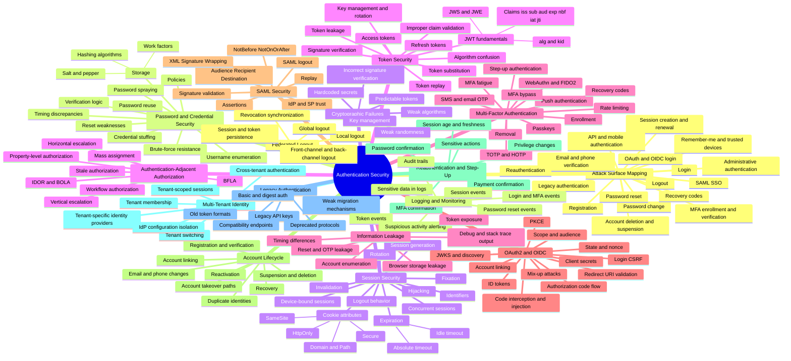

# Authentication Security Master Mind Map

This is the root map for the entire hunting guide. It shows every authentication and authentication-adjacent domain in one place, and how they relate to each other. Use it to orient yourself at the start of an assessment, then drop into the relevant grouped sub-map (`mindmaps/`) or attack guide (`attack-guides/`) for depth.

Two diagrams follow. The first is the taxonomy: every domain and its sub-topics, structured as a tree. The second is the relationship map: how a weakness in one domain actually creates or compounds a weakness in another, because real findings almost never stay inside one branch.

## 1. Taxonomy

## 2. Relationship and attack-path map

A weakness in one domain is rarely the whole story. This diagram shows the relationships that matter most in practice — where one finding is the precondition for another, or where two weak controls compound into something reportable.

```mermaid
flowchart TD
    ENUM[Account enumeration] --> CREDATK[Credential stuffing / password spraying]
    ENUM --> RESETLEAK[Targeted password-reset abuse]
    CREDATK --> WEAKSTORE[Weak password storage confirms hit rate]
    RESETLEAK --> TOKENWEAK[Predictable or reusable reset token]
    TOKENWEAK --> ATO1[Account takeover]
    WEAKSTORE --> ATO1

    MFADOWNGRADE[Inconsistent MFA enforcement across routes] --> LEGACY[Legacy or alternate auth route]
    LEGACY --> MFADOWNGRADE
    MFADOWNGRADE --> ATO2[Account takeover without second factor]

    JWTALG[JWT algorithm confusion or weak secret] --> SESSION[Forged session / access token]
    SESSION --> AUTHZ1[Authorization bypass]
    OIDCNONCE[Missing or reused OIDC state/nonce] --> CSRFLOGIN[Login CSRF]
    CSRFLOGIN --> ACCTLINK[Forced account linking]
    ACCTLINK --> ATO3[Account takeover via federation]

    SAMLSIG[SAML signature not fully validated] --> XSW[XML Signature Wrapping]
    XSW --> IDENTITYSPOOF[Spoofed assertion identity]
    IDENTITYSPOOF --> ATO4[Account takeover via SSO]

    STALEAUTHZ[Stale authorization after role/tenant change] --> TENANTCROSS[Cross-tenant data access]
    MASSASSIGN[Mass assignment on registration or profile update] --> PRIVESC[Vertical privilege escalation]
    IDOR[IDOR / BOLA] --> HORIZ[Horizontal privilege escalation]
    HORIZ --> CHAIN1[Chained with weak session revocation]
    CHAIN1 --> SCALE1[Account-wide data exposure]

    REAUTHMISSING[Missing step-up auth on sensitive action] --> SENSOP[Unauthorized sensitive operation]
    SENSOP --> PRIVESC
    SENSOP --> STALEAUTHZ

    LOGOUTFAIL[Logout does not revoke server-side session] --> PERSIST[Persistent unauthorized access]
    FEDLOGOUTFAIL[Federated logout not propagated] --> PERSIST

    INFOLEAK[Information leakage: errors, timing, debug output] --> ENUM
    INFOLEAK --> TOKENWEAK
    INFOLEAK --> JWTALG

    LOGGINGGAP[Missing or incomplete auth logging] -.weakens detection of.-> ATO1
    LOGGINGGAP -.weakens detection of.-> ATO2
    LOGGINGGAP -.weakens detection of.-> ATO3
```

## 3. Domain-to-source traceability

Every branch above is built from a reconciliation of three source types, not invented. This table is the map from taxonomy branch to where its depth actually comes from.

All 17 attack guides are now complete, and every checklist phase cited below was read in full before the corresponding guide was built — not skimmed, not assumed. This table is current as of that completion, not a forward-looking plan.

| Domain | Course phase(s) | Testing Approach phase | Checklist phase(s) | Attack guide |
|---|---|---|---|---|
| Attack Surface Mapping | All phases, entry points | Phase 1 | Phase 1 | `01-ATTACK-SURFACE-MAPPING.md` |
| Password and Credential Security | Phase 1 | Phase 5 | Phase 5 | `02-PASSWORD-AND-CREDENTIAL-ATTACKS.md` |
| Session Security | Phase 6 | Phase 8 | Phase 6 | `03-SESSION-SECURITY.md` |
| Token Security (JWT) | Phase 16 (crypto) | Phase 12 | Phase 16 (JWT/token-specific portions only) | `04-JWT-AND-TOKEN-SECURITY.md` |
| Multi-Factor Authentication | Phases 3-5 | Phase 7 | No dedicated phase — sourced from Testing Approach Phase 7 and course Phases 3-5 directly, flagged honestly in the guide | `05-MFA-ATTACKS.md` |
| Password Reset and Recovery | Phase 2 | Phase 6 | Phase 5 (TESTs 3.6/5.7) + Phase 3 (sections 6, 9, 22) | `06-PASSWORD-RESET-AND-RECOVERY.md` |
| OAuth2 and OIDC | Phase 7 | Phase 10 | Phase 7 | `07-OAUTH2-AND-OIDC.md` |
| SAML Security | Phase 10 | Phase 10 | Phase 10 | `08-SAML-SECURITY.md` |
| Account Lifecycle | Phase 8 | Phase 4 | Phase 8 | `09-ACCOUNT-LIFECYCLE.md` |
| Reauthentication and Step-Up | Phase 9 | Phase 9 | Phase 9 | `10-REAUTHENTICATION.md` |
| Multi-Tenant Identity | Phase 11 | Phase 14 (as part of authz) | Phase 11 | `11-MULTI-TENANT-IDENTITY.md` |
| Legacy Authentication | Phase 13 | Phase 11 | Phase 4 + Phase 13 "Mastery" (BB-08 through BB-13 specifically) | `12-LEGACY-AUTHENTICATION.md` |
| Federated Logout | Phase 14 | Phase 10 | Phase 14 | `13-FEDERATED-LOGOUT.md` |
| Authentication Logging | Phase 15 | Phase 13 | Phase 15 | `14-AUTHENTICATION-LOGGING.md` |
| Cryptographic Failures | Phase 16 | Phase 12 | Phase 16 (general-purpose portions, excluding what Guide 04 owns) | `15-CRYPTOGRAPHIC-FAILURES.md` |
| Authentication-Adjacent Authorization | Phase 17 | Phase 14 | Phase 17 (final phase of the checklist file) | `16-AUTHENTICATION-ADJACENT-AUTHORIZATION.md` |
| Information Leakage | Phase 12 | Phase 3 | Phase 12 "Mastery" (primary) + Phase 3 (supplementary) | `17-INFORMATION-LEAKAGE.md` |

Two guides (05 and 12) drew from more than one checklist location rather than a single clean phase — both flag this honestly in their own source notes rather than presenting a tidier-looking but inaccurate picture.

## 4. How to use this map on a real assessment

Start at the top of the taxonomy to orient yourself, but hunt using the relationship map. In practice, findings cluster around a small number of entry points: account enumeration, inconsistent MFA or route enforcement, token validation gaps, and stale authorization after a state change. Each of those sits at the top of a chain in section 2, not at the bottom — which is why attack-surface mapping and baseline establishment come before any single vulnerability class in the hunting workflow (see `MASTER-TESTING-METHODOLOGY.md`, not yet built).
