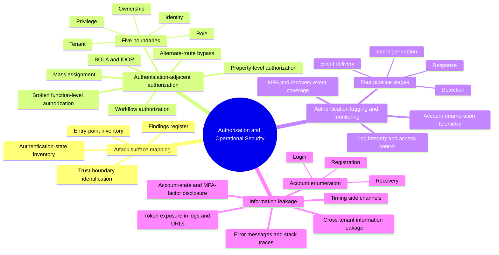

# Authorization and Operational Security — Mind Map

The seventh cluster, not explicitly named in the original master prompt but needed to cover the remaining four guides, which share a cross-cutting character distinct from the other six clusters: `attack-guides/01-ATTACK-SURFACE-MAPPING.md` (the reconnaissance discipline every other guide depends on), `attack-guides/16-AUTHENTICATION-ADJACENT-AUTHORIZATION.md` (what happens *after* authentication succeeds), `attack-guides/14-AUTHENTICATION-LOGGING.md` (whether any of this is observable when it goes wrong), and `attack-guides/17-INFORMATION-LEAKAGE.md` (what every other mechanism inadvertently exposes along the way). None of these are a single credential or protocol — they're disciplines that cut across every other cluster in this course.

## Why this cluster holds together

Attack surface mapping is the thing you do *before* everything else in this course — it's not a vulnerability class, it's the discipline that makes every other guide's testing targeted instead of guesswork. Authorization is the thing that matters *after* every other guide's mechanism has already succeeded — a perfectly authenticated session is only half the story if the server never checks what that identity is allowed to touch. Logging and information leakage are the two sides of the same observability coin: logging is whether the *defenders* can see what happened, information leakage is whether *attackers* can see more than they should. None of these four fit naturally into a single-mechanism cluster because they're not mechanisms — they're the process, the boundary, and the visibility layer wrapped around every mechanism the other six clusters cover.

## Entry point

Start every real assessment with `01-ATTACK-SURFACE-MAPPING.md` regardless of which other clusters apply. Move to `16-AUTHENTICATION-ADJACENT-AUTHORIZATION.md` once any authentication mechanism has been tested and confirmed working — authorization testing presupposes a valid identity to test *with*. Use `17-INFORMATION-LEAKAGE.md` continuously throughout an assessment rather than as a discrete phase, since leakage shows up inside the testing of every other guide. Use `14-AUTHENTICATION-LOGGING.md` last, or in parallel, to check whether anything found elsewhere would actually have been detected.
