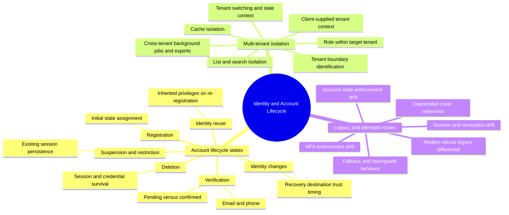

# Identity and Account Lifecycle — Mind Map

Zoom-in covering `attack-guides/09-ACCOUNT-LIFECYCLE.md`, `attack-guides/11-MULTI-TENANT-IDENTITY.md`, and `attack-guides/12-LEGACY-AUTHENTICATION.md`. These three share a structural theme distinct from the rest of the course: they're not about a single mechanism (a password, a token, an MFA factor) — they're about *which version of the identity system a request actually passes through*, across time (lifecycle state), across organizational boundaries (tenancy), and across technical generations (legacy versus current routes).

## Why this cluster holds together

Each of these guides asks a version of "which policy actually applies to this specific request" rather than "is this credential valid." An account's lifecycle state determines what it's currently allowed to do; a tenant boundary determines whose data a valid identity can touch; a legacy route determines whether the *current* security policy even applies at all, or whether an older, weaker one silently governs this specific path instead. All three are fundamentally about policy drift — between states, between tenants, between code paths — rather than about breaking a single mechanism.

## Entry point

Start with `09-ACCOUNT-LIFECYCLE.md` for the state-transition foundation, since lifecycle state interacts with both of the other two guides (a legacy route might not check suspension state; a tenant-switch might not re-check verification state). Then `11-MULTI-TENANT-IDENTITY.md` if the target is multi-tenant, and `12-LEGACY-AUTHENTICATION.md` to check whether any of the fixes assumed elsewhere in this course actually apply to every reachable route. Cross-reference `AUTHORIZATION-AND-OPERATIONAL-SECURITY.md` for when a lifecycle or tenant gap becomes a formal BOLA or tenant-isolation authorization finding.
