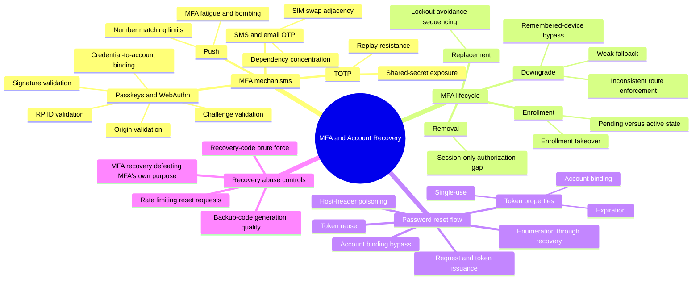

# MFA and Account Recovery — Mind Map

Zoom-in covering `attack-guides/05-MFA-ATTACKS.md` and `attack-guides/06-PASSWORD-RESET-AND-RECOVERY.md`. These two are bundled deliberately: every recovery flow is a potential second factor in disguise, and every MFA implementation needs its own recovery path — the two are structurally the same problem (how does the system let someone back in without their normal credential) applied to two different credentials.

## Why this cluster holds together

The central, recurring failure in this entire cluster is a fallback path that's weaker than the thing it's a fallback *for*. MFA exists to raise assurance above a password; if its removal only needs a valid session, or its recovery just needs an email click, the second factor was theater. Password reset exists to restore access without the password; if the reset token isn't properly bound, expired, and single-use, it's a second, usually weaker, password. Both guides are ultimately testing the same invariant from different directions: does the recovery mechanism accidentally provide an easier path in than the thing it's recovering.

## Entry point

Start with `05-MFA-ATTACKS.md` for the factor-specific attacks and the full enrollment/removal/replacement lifecycle, then `06-PASSWORD-RESET-AND-RECOVERY.md` for the token-lifecycle and Host-header-poisoning depth. Cross-reference `AUTHENTICATION-CRYPTOGRAPHY.md` for recovery-token and backup-code randomness quality specifically, and `IDENTITY-AND-ACCOUNT-LIFECYCLE.md` for what happens to MFA state across suspension, deletion, and restoration.
