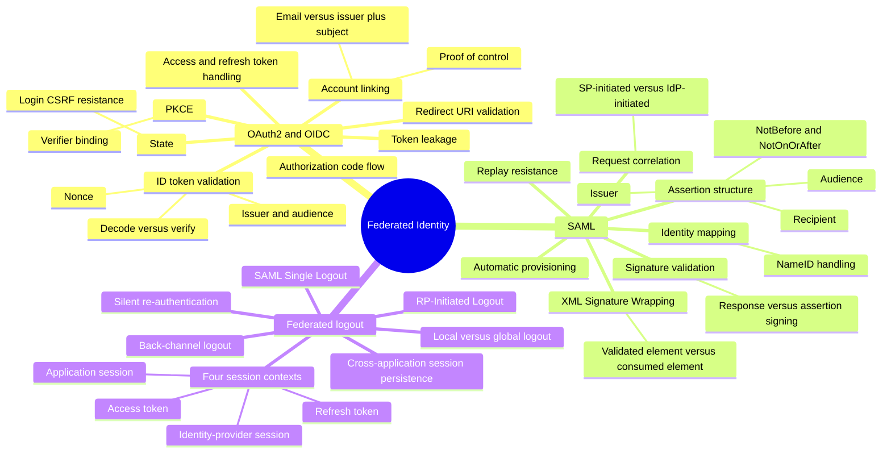

# OAuth, OIDC, SAML, and Federated Logout — Mind Map

Zoom-in covering `attack-guides/07-OAUTH2-AND-OIDC.md`, `attack-guides/08-SAML-SECURITY.md`, and `attack-guides/13-FEDERATED-LOGOUT.md`. Federated identity's three concerns naturally cluster: the two protocols that establish trust (OAuth/OIDC and SAML), and the logout problem that only exists *because* trust is now distributed across multiple independent sessions instead of living in one place.

## Why this cluster holds together

Every one of these three guides is testing a version of the same question: when trust is established or terminated by a message passed between independent systems, does the receiving system validate *everything* it needs to before acting on that message — not just that the message is signed, but that it's signed by the right party, for the right audience, for the right transaction, and (for logout) actually reaches every session it's supposed to terminate. OAuth/OIDC and SAML are the two dominant ways trust gets *established* this way; federated logout is what happens when that same distributed-trust architecture has to be *unwound* cleanly, and it inherits the same fragility.

## Entry point

Start with whichever protocol the target actually implements (`07-OAUTH2-AND-OIDC.md` or `08-SAML-SECURITY.md` — rarely both in depth). Always follow up with `13-FEDERATED-LOGOUT.md` regardless of protocol, since logout correctness is commonly tested far less than login correctness and the gap is correspondingly larger. Cross-reference `SESSION-AND-TOKEN-SECURITY.md` for how the resulting local session/token behaves once federation has established it, and `AUTHENTICATION-CRYPTOGRAPHY.md` for the signature-verification depth both protocols share with JWT.
