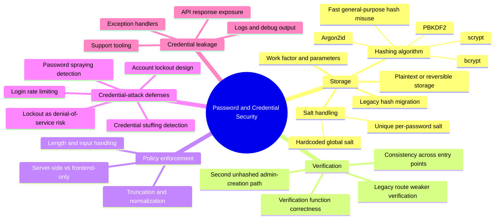

# Password and Credential Security — Mind Map

Zoom-in on one branch of `AUTHENTICATION-MASTER-MIND-MAP.md`. Maps to a single attack guide: `attack-guides/02-PASSWORD-AND-CREDENTIAL-ATTACKS.md`. Password reset and recovery — the *lifecycle* side of password security — is deliberately handled in the separate `MFA-AND-ACCOUNT-RECOVERY.md` sub-map, since it shares more with MFA recovery than with storage/verification.

## Why this cluster holds together

Everything here answers one question: if the password database is ever compromised, or an attacker tries to guess their way in online, what actually stops them? Storage and verification determine the *offline* resistance (what happens after a breach); rate limiting and abuse defenses determine the *online* resistance (what happens during an active guessing attempt). Both fail independently — a perfectly hashed password database doesn't help if the login endpoint has no rate limit, and a tight rate limit doesn't help if the stored hash is a fast, unsalted SHA-256.

## Entry point

Start with `attack-guides/02-PASSWORD-AND-CREDENTIAL-ATTACKS.md` for the full A–M testing methodology. Cross-reference `AUTHENTICATION-CRYPTOGRAPHY.md` for the cryptographic-correctness angle on hashing parameters specifically, and `MFA-AND-ACCOUNT-RECOVERY.md` for what happens when a password needs to be reset rather than just verified.
