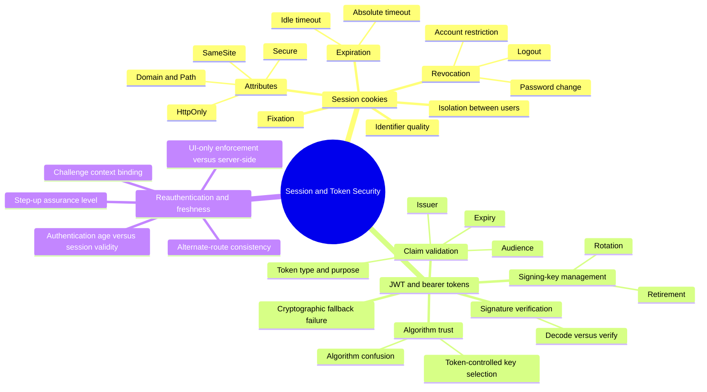

# Session and Token Security — Mind Map

Zoom-in covering three attack guides that all answer the same underlying question — *is this credential still the one the server thinks it is, and is it still valid right now* — from three different angles: `attack-guides/03-SESSION-SECURITY.md` (cookies and server-side sessions), `attack-guides/04-JWT-AND-TOKEN-SECURITY.md` (signed bearer tokens), and `attack-guides/10-REAUTHENTICATION.md` (freshness and assurance level on top of validity).

## Why this cluster holds together

A session cookie, a JWT, and a "please re-enter your password" prompt are three different mechanisms for the same underlying guarantee: that the server can trust *who* is making this specific request *right now*. They fail the same way conceptually even though the technical details differ completely — a session surviving logout, a token surviving signature failure via a fallback branch, and a sensitive operation accepting stale authentication are all instances of "the server trusted a credential state it should have rejected."

## Entry point

Work through `03-SESSION-SECURITY.md` first for the baseline cookie/session lifecycle, then `04-JWT-AND-TOKEN-SECURITY.md` if the target uses signed bearer tokens, then `10-REAUTHENTICATION.md` for sensitive operations layered on top of either. Cross-reference `AUTHENTICATION-CRYPTOGRAPHY.md` for the signing-key management depth this cluster deliberately defers there, and `OAUTH-OIDC-AND-SAML.md` for how access/refresh/ID tokens behave specifically inside a federated flow.
